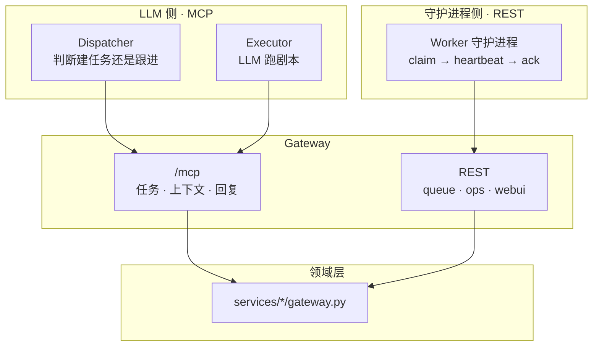
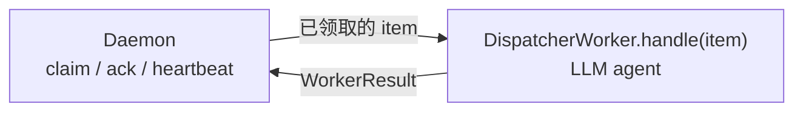
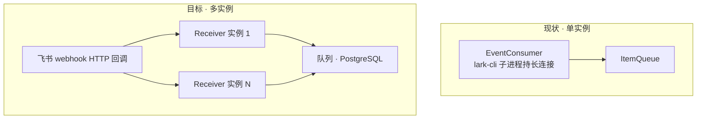

# 20261117 MCP 上线记录与后续方案

本文记录 2026-11-17 上线的 MCP（Model Context Protocol）改动，以及围绕「服务端不提供 LLM、只做队列/任务/状态/消息代理」这个目标讨论出的后续方案。

## 1. 本次已上线的改动

Gateway 已部署包含 MCP 的版本，参见下方的上线验证。

### 1.1 分层重构

把 IM 与任务的业务逻辑从 HTTP 层搬到独立 service 层，让 REST 与 MCP 共用同一套领域动作。

| 新文件 | 职责 |
|---|---|
| `app/services/im/gateway.py` | 入站项读取、任务发送校验、按入站回复、出站消息与任务关联、消息上下文 |
| `app/services/tasks/gateway.py` | 任务列表、任务详情、追加跟进（含台账同步补偿） |
| `app/api/mcp.py` | MCP Server 与 5 个工具、Bearer 鉴权、作用域校验 |

`app/api/im.py` 净删约 140 行，API 层只保留「解析 + 异常映射」：`ImGatewayError(status_code)` 映射为 4xx，`LarkCliError` 映射为 502。

### 1.2 MCP 工具面（5 个）

| 工具 | 对应 REST | 说明 |
|---|---|---|
| `list_tasks` | `GET /tasks` | 按业务群查近期任务 |
| `get_task` | `GET /tasks/{id}` | 任务详情、契约、近期事件 |
| `get_message_context` | `POST /im/messages/context` | 按入站项 ID 读取飞书上下文与直接引用目标 |
| `append_task_followup` | `POST /tasks/{id}/followups` | 追加跟进并同步台账，支持幂等重试 |
| `reply_to_inbound` | `POST /im/respond` | 按入站项 ID 回复原消息 |

安全设计：

- `GATEWAY_MCP_TOKEN` 是独立的静态 token。MCP 初始化成功且 token 未配置时，`/mcp` 返回 503。
- `bot_store.get_chat_binding` 校验业务群绑定，配置 `GATEWAY_MCP_CHAT_IDS` 可进一步限制允许访问的群。
- 超出授权群范围的任务与消息请求会被拒绝。
- 默认 Host 允许列表包含本机回环地址。远程访问通过 `GATEWAY_MCP_ALLOWED_HOSTS` 配置，客户端发出 Origin 时另外通过 `GATEWAY_MCP_ALLOWED_ORIGINS` 校验。
- `stateless_http=True` 采用无会话传输。断线后的写操作使用幂等键重试。

### 1.3 跟进幂等与台账补偿

- `task_events` 新增 `idempotency_key`、`board_sync_json`，并建 partial 唯一索引 `(task_id, idempotency_key) WHERE idempotency_key IS NOT NULL`
- 命中相同 key 时返回原事件；参数不一致抛 `TaskConflictError`
- 首次台账同步失败时，用相同 key 重试只补台账、不重复记账（`record_followup_board_sync`）

### 1.4 上线加固

| 加固项 | 原因 |
|---|---|
| MCP 可降级（`app/main.py`） | SDK 导入或 MCP 初始化失败时记录告警并保留 REST，`/mcp` 返回 404。设置 `GATEWAY_MCP_REQUIRED=true` 时，这些错误会中止启动 |
| `httpx2` 显式声明 | 测试直接 import，但此前只是 mcp 的传递依赖 |
| 建表定义补新列 | 新库不再依赖迁移补列 |
| 迁移建索引 | 索引必须在 `_migrate_schema` 里、补列之后创建；若写进 `_SCHEMA`，老库会因列不存在而启动失败 |

上线检查确认 `/live` 返回 200、`/health` 正常，未配置 token 的 `/mcp` 返回 503。五个 MCP 工具通过隔离环境联调验证。

## 2. 核心设计判断

后续所有取舍都基于两条边界。

### 2.1 谁用 MCP，谁用 REST

判断标准只有一句：**需要模型做决策的那一端用 MCP；纯机械循环的那一端用 REST。**



Worker 守护进程不适合 MCP 的三个理由：

1. **错误语义**。Worker 已用 REST 的 HTTP 409 识别租约冲突，跳过任务开始或收尾。
2. **心跳**。守护进程已有通过 REST 续租的循环，迁移协议需要重新处理续租失败与重试。
3. **调试**。现有队列排障可以直接用 curl 查询 HTTP 状态与响应。

### 2.2 编排权在服务端外部，agent 不接触队列

保留现有链路：外部编排程序先 claim，再把「一条已领取的消息」交给 agent 处理。



这个约束的价值在于它是天然的审计与成本边界：

- 一次唤起 = 一条消息 = 一条审计记录，不会出现「agent 自己把队列吃干」
- token 消耗可以按消息条数线性预估
- 服务端按 `dispatch_runs.inbound_id` 去重分发记录，按 `tasks.created_from_inbound_id` 去重建任务。迁移发现旧任务重复时会跳过任务唯一索引。

**由此得出一条硬性约束：MCP 工具面永远不出现 `claim` / `ack` / `nack` / `heartbeat`。这是设计边界，不是功能遗漏。**

## 3. 后续方案

### 3.1 P0：MCP 工具面对齐（阻塞 dispatcher 迁到 MCP）

当前 MCP 只覆盖 agent 所需 7 个工具中的 4 个。

| agent 工具 | 调用的 REST | MCP 现状 |
|---|---|---|
| `fetch_message_context` | `POST /im/messages/context` | 已有 `get_message_context` |
| `list_open_tasks` | `GET /tasks` | 部分：MCP 缺 `thread_id` / `project_id` / `kind` |
| `get_task` | `GET /tasks/{id}` | 已有 |
| `followup_task` | `POST /tasks/{id}/followups` | 已有 `append_task_followup` |
| `get_chat_project` | `GET /chat-projects/{chat_id}` | **缺** |
| `create_task` | `POST /tasks` | **缺** |
| `finalize_dispatch` | `POST /dispatcher/runs` | **缺** |

#### 分发结果需要持久化

Dispatcher worker 调用模型前会查询 `GET /dispatcher/runs/{inbound_id}`。任务写入后如果缺少分发记录，重试可能再次调用模型或重复追加跟进。已有的建任务去重按 `created_from_inbound_id` 生效。

目前 `DispatchRunStore.create_run` 按 `inbound_id` 返回已有记录。开放 `finalize_dispatch` 前，服务端还需校验调用方有权处理当前入站项、租约仍有效、任务同属授权群，并验证分发结论与本次任务写入一致。重试仅接受语义相同的结论，冲突结论应返回错误。

#### `list_tasks` 过滤参数要全透传

`services/tasks/gateway.py` 已支持 `status` / `bot_id` / `chat_id` / `thread_id` / `project_id` / `kind` / `limit`。当前 MCP 暴露 `chat_id` / `status` / `limit` 并要求 `chat_id`。Dispatcher 需要按 `thread_id` 等筛选任务，省略 `chat_id` 时也要在服务端按调用方授权群限制结果。

#### 建议新增工具签名

下面是模型可见的参数。编排程序通过受信调用上下文传递当前入站项的租约凭据，由服务端验证。

```python
@server.tool(name="create_task")
async def create_task(
    chat_id: NonBlank,
    title: NonBlank,
    kind: str,
    one_liner: str = "",
    thread_id: str | None = None,
    project_id: str | None = None,
    created_from_inbound_id: int | None = None,
    message: str | None = None,
) -> dict: ...

@server.tool(name="get_chat_project")
async def get_chat_project(chat_id: NonBlank) -> dict: ...

@server.tool(name="finalize_dispatch")
async def finalize_dispatch(
    inbound_id: PositiveId,
    decision: str,
    reason: NonBlank,
    task_id: int | None = None,
    evidence: Any = None,
) -> dict: ...
```

`create_task` 校验 `created_from_inbound_id` 与本次领取记录一致，`finalize_dispatch` 校验它记录的决策与实际写入一致。已有唯一约束可用于重试去重。

### 3.2 P1：审计加固

#### 服务端补写侧不变量

`state.has_written()` 的「一条入站只允许一次写」目前只在客户端实现（`workers/dispatcher/tools.py`）。服务端按 `tasks.created_from_inbound_id` 去重建任务。按入站项对 followup 去重需要增加约束。

建议在 `add_followup` 增加一条约束：同一 `inbound_id` 只允许一次 `actor='dispatcher'` 的写。这样即使客户端有 bug，审计记录也不会被污染。

#### MCP 审计日志

当前 5 个工具缺少统一的操作审计。审计记录至少包含客户端标识、工具名、`chat_id` / `task_id` / `inbound_id`、幂等是否命中和耗时。

### 3.3 P2：WebUI 前置

#### 中间件是什么

中间件是「请求进入业务函数之前、响应返回客户端之前，统一插一段逻辑」的全局钩子，不针对单条路由。示例语义：

```python
async def some_middleware(request, call_next):
    before = do_something(request)
    response = await call_next(request)
    after = do_something_else(response)
    return response
```

CORS 是浏览器用于控制跨源访问的机制。前端跨源发送带 `Authorization` 的请求时，浏览器先发 `OPTIONS` 预检，预检通过后才发送实际请求。

**由此推论：同源部署不需要 CORS，也就不需要这个中间件。**

#### 建议的最小形态

```
同一个 FastAPI 进程
  /tasks、/queue、/im 等  现有 REST，bearer token，给程序与 worker 用
  /ui/*       前端静态构建产物，同源，浏览器直接访问
  /ui/api/*   WebUI 专用读接口，走 Cookie Session 而非 bearer
  /ui/api/events  看板实时刷新（SSE 或 WebSocket）
```

关键约定：

- WebUI 的读接口走 REST，**不走 MCP**。MCP 不做 WebUI 的数据通道
- 看板实时刷新**不要复用 MCP 的 SSE**（那是 tool 调用的传输通道），另开端点
- 只有在决定前后端分离部署时，才引入 CORS 与严格的 origin 白名单

REST 的 `check_token` 根据配置验证 `Authorization: Bearer`。WebUI 计划使用独立会话鉴权。

### 3.4 P2：任务层级与树状图

现有 `tasks` 表是扁平的，归类维度只有 `chat_id` / `thread_id` / `project_id` / `kind`，没有任何父子关系字段。契约层已有 `parent_task` 作为语义枚举（`SourceRole` 与 `DestinationKind`），但没有结构性连接。

两条可选路径：

| 方案 | 结构 | 适合 | 代价 |
|---|---|---|---|
| A. 邻接表 | `tasks.parent_id` 自引用 + 索引 | 严格一棵树，子任务归属唯一 | 简单；将来要 DAG 需再迁移 |
| B. 关系表 | `task_links(from_id, to_id, kind)` | 一个任务可属于多条线；`blocks` / `depends_on` / `parent` | 查询需递归 CTE，但与编排最契合 |

**建议采用 B，先只启用 `parent` 一种 kind。** 理由：编排天然是图而不是树（一个任务可能被两条流程依赖）。用 `task_links` 起步，树状图就是 `WHERE kind='parent'` 的结果，避免以后做第二次迁移。

参考结构：

```sql
CREATE TABLE IF NOT EXISTS task_links (
    from_task_id INTEGER NOT NULL,
    to_task_id   INTEGER NOT NULL,
    kind         TEXT    NOT NULL,   -- parent | blocks | depends_on
    created_at   TEXT    NOT NULL,
    created_by   TEXT    NOT NULL DEFAULT 'api',
    PRIMARY KEY (from_task_id, to_task_id, kind),
    FOREIGN KEY (from_task_id) REFERENCES tasks(id),
    FOREIGN KEY (to_task_id)   REFERENCES tasks(id)
);
CREATE INDEX IF NOT EXISTS idx_task_links_to ON task_links(to_task_id, kind);
```

注意约束：禁止自环，写入时校验 `from_task_id != to_task_id`；删除任务时按 kind 级联清理。

### 3.5 P3：公网与水平扩展

#### 数据库

单实例部署使用本地磁盘上的 SQLite + WAL。公网前计划换 PostgreSQL。

`TaskStore` / `ItemQueue` / `DispatchRunStore` 已把 SQL 细节封装在各自模块内，替换属于实现级改动。但要注意代码中多处 `BEGIN IMMEDIATE` 用于串行化写，迁移到 PostgreSQL 时需改为对应的行锁或事务隔离级别。

#### 水平扩展的瓶颈不在队列

`ItemQueue` 已把存储细节封装（claim / ack / nack / heartbeat / stats），换存储是替换实现而非重设计。真正的瓶颈是入站接收器：



`EventConsumer` 依赖 lark-cli 子进程持有飞书长连接，起两个实例会导致重复消费或随机只有一方收到。要真正多实例，需要把事件接入从长连接订阅改成 webhook HTTP 回调：

- Receiver 变成无状态 HTTP 端点，可 N 个实例
- 飞书会重试推送，因此必须用 `message_id` 做入队去重；`ItemQueue` 已支持 `idempotency_key`
- 需要处理飞书的 URL 校验，以及可选的加密

出站同样绑本机：发消息与上传媒体都依赖 lark-cli 与本机 bot 配置、user 登录态。多实例时每个实例都需要可用凭据，且 user token 刷新状态可能需要共享。这块比入站更难，需单独评估。

**当前结论：暂不做水平扩展。** 但值得先做一件零成本的事——把 `EventConsumer` 与 `ItemQueue` 的边界写清楚（consumer 只负责「变成一条带 `message_id` 幂等键的队列项」），将来换 webhook 时改动被限制在一个文件内。

#### 凭据模型

当前 `GATEWAY_TOKEN` 与 `GATEWAY_MCP_TOKEN` 是两把独立钥匙，但它们都是进程级静态 token，所有客户端共用：

- dispatcher 与 worker 权限完全相同，无法按群、按能力隔离
- 无法单独吊销或轮换，无法审计「是谁做的」
- token 泄露即全盘失守

公网前建议引入客户端凭据表：

```sql
CREATE TABLE IF NOT EXISTS mcp_clients (
    client_id       TEXT PRIMARY KEY,
    secret_hash     TEXT NOT NULL,
    scopes          TEXT NOT NULL DEFAULT '',      -- 逗号分隔的工具或能力名
    allowed_chat_ids TEXT NOT NULL DEFAULT '',     -- 空表示跟随全局
    enabled         INTEGER NOT NULL DEFAULT 1,
    created_at      TEXT NOT NULL,
    last_seen_at    TEXT
);
```

同时把 `GATEWAY_MCP_TOKEN` / `GATEWAY_MCP_CHAT_IDS` 降级为「单租户兼容模式」。

优先做这件事的理由：它同时解开多客户端、权限隔离、审计、WebUI 人类账号四个问题，且不依赖任何协议层决策。

## 4. 约束与红线

1. **服务端不提供 LLM 能力。** MCP 侧不实现 `sampling`，不反向借用客户端模型。
2. **MCP 不出现队列 claim / ack / nack / heartbeat。** 编排权在服务端外部的编排程序。
3. **MCP 不做 WebUI 数据通道。** WebUI 走 REST + 独立会话鉴权。
4. **长任务不得阻塞 tool 调用。** 编排程序通过 REST 领取任务，在请求之外执行，再调用服务回报结果。
5. **写操作必须可重试。** `stateless_http` 无断线续传，幂等键是必需项而非可选优化。

## 5. 优先顺序

| 优先级 | 事项 | 目标 |
|---|---|---|
| P0 | MCP 补 `create_task` / `get_chat_project` / `finalize_dispatch`，为关联写入校验租约与授权范围，`list_tasks` 透传过滤参数 | dispatcher 可通过 MCP 工作 |
| P1 | 服务端补「一条入站一次写」约束；MCP 加审计日志 | 审计可信 |
| P2 | `task_links` 表；同源挂 `/ui` 与会话鉴权 | 支撑树状看板 |
| P3 | PostgreSQL；`EventConsumer` 改 webhook；客户端凭据表 | 公网与多实例 |

## 6. 相关文件索引

| 关注点 | 文件 |
|---|---|
| MCP Server 与工具 | `app/api/mcp.py` |
| 应用装配与降级 | `app/main.py` |
| IM 领域动作 | `app/services/im/gateway.py` |
| 任务领域动作 | `app/services/tasks/gateway.py` |
| 跟进幂等与台账补偿 | `app/services/tasks/store.py` |
| 建表与迁移 | `app/infra/db.py` |
| 队列与领取语义 | `app/api/queue.py`、`app/services/queue/service.py` |
| 编排守护进程 | `workers/daemon.py` |
| Dispatcher agent 工具面 | `workers/dispatcher/tools.py` |
| 事件接入 | `app/infra/events/consumer.py`、`app/infra/events/manager.py` |
| 设计蓝图 | `docs/blueprint.md` |
