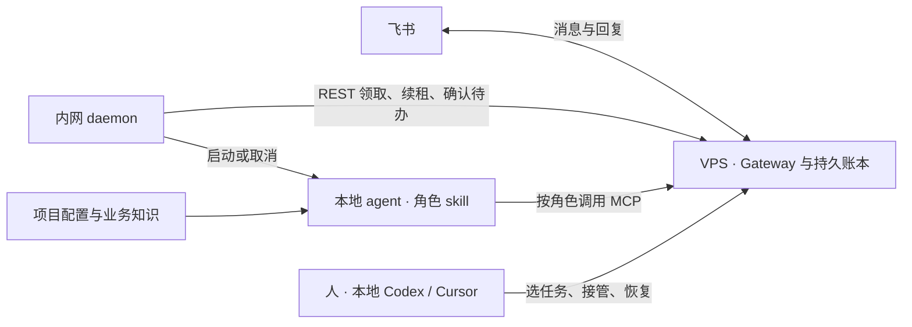

# lark-superbot 产品方向：人与 agent 共用的任务账本

**目标设计 · 2026-11-19。** 一个人隔了两周打开某项交付，或一个新启动的 agent 第一次接手，都应该能从同一条任务看清：当时答应了什么、目前进展如何、依据在哪、下一步由谁决定。发起人可以在飞书补充需求，维护者可以在本地 Codex 或 Cursor 选任务，也可以随时收回控制权。

第一个日常使用的版本只覆盖一个项目。router 自动分发消息，task_owner 由内网 daemon 自动唤起，你主动挑选任务并在本地充当 worker。本文约定产品职责和任务语义。实施次序、eval 和上线门槛见[阶段路线图](20261119-task-coordination-roadmap.md)。当前分支的启动方法与接口见 [README](../README.md)。

## 一条消息怎样变成可接手的工作

以月度交付为例。业务方在飞书说：“10 月源表到了。另外，9 月验收口径里应该排除退款。”

1. Gateway 收件，原文存一次。router 根据项目配置中每月的交付流程、期次、已有任务与回复链，把第一句挂到“10 月／收源表”，把第二句挂到“9 月／验收”。每条关联都能找回原句和判断依据。
2. 10 月任务只需留存新材料。9 月的更正可能改变验收条件，服务为该任务登记 owner 待办，daemon 再拉起 task_owner。同一消息的重复投递应得到相同的关联和待办。
3. 9 月 owner 对照原契约，判断这是已确认的口径变更，还是一项待核实的建议。前者保存新版本并说明依据；后者记录未决问题。需要独立跟进时，owner 可以建“确认 9 月退款口径”的子任务。
4. 本地 worker 接手明确的委托，查材料、提问或执行，写回结果、证据和阻塞原因。发现契约与实际不符时，由 worker 提出异议，交回 owner 或人工修订。发往业务群的答复保留责任人和发送记录；同一条消息挂到两项任务不应产生两次相同回复。

router 只把消息挂到已有节点（follow-only）。有业务意义但暂时无法归属的部分进入项目根节点的待办，由根 owner 判断是否建任务或重挂；确认无关的消息记录略过原因。候选查询失败应重试并留下错误，空结果才表示确实没有查到候选。

## 服务和角色各自负责什么

VPS 运行飞书 CLI，保存任务、契约修订、来源证据、消息关联、待办和执行记录。Gateway 校验权限、当前控制权和版本，负责可靠记账及受控外发。内网 daemon 管理 agent 的进程生命周期；角色按需启动，等待外部事件时可以退出。更换运行后端时，下一轮凭任务号、触发原因、角色和 skill 版本接续。拟支持的后端包括 pi、Cursor CLI 和 Codex CLI，先用一个后端验通。

| 角色 | 可交付的结果 | 权限范围 |
|---|---|---|
| router | 消息各部分的任务归属、证据与理由 | 可读项目上下文和候选任务，可挂证据。建任务和改契约由 owner 处理 |
| task_owner | 有边界的契约、当前叙事、检索标签、子任务、下一步委托 | 可修订自己负责的任务结构及归属。业务仓库写入、作业执行等能力只授予相应 worker |
| worker | 实际交付物、工作记录、待澄清项或变更建议 | 按契约行动，对交付和外发留证。服务端只允许有维护权限的身份改契约 |
| 人与后续 supervisor | 人可调整方向、接管或恢复。supervisor 按项目配置复核 owner 的变更或 worker 的交付 | 验收依据可来自代码 review、交付 QA 等项目 skill。先记录人工判断，再验证自动复核能力 |

router 需要足够的项目知识才能分辨“哪一期、哪一步”。VPS 保存群与项目的绑定、任务所属期次和稳定标识，内网提供分发所需的项目词汇、职责、标准流程及当前配置版本。每次路由保留使用的配置版本，项目规则改动后仍能复盘旧判断。

## 任务树、契约与叙事

每个项目先有根节点。一个任务有一个主要父节点，以便回答“它为哪项交付负责”；一条消息或一份材料可以关联多项任务。项目的五个标准步骤先作为路由上下文。当某一步有**独立可验收的结果**，又值得单独委托、等待、暂停或重开时，owner 才创建对应期次的子任务。父任务由父 owner 对整体交付验收。

| 要记录的内容 | 回答的问题 |
|---|---|
| 契约 | 这次交付的目标或结果是什么？对象、期次、纳入与排除的范围是什么？如何验收？遇到什么要停下或交回？ |
| 叙事与标签 | 事情进展到了哪里，有什么新事实，正在等谁，下一步是什么？哪些项目词汇能帮助后来者找到这条任务？ |
| 证据与历史 | 哪条原消息、回复、产物或人的决定支持上述判断？谁在何时、基于哪一版契约做了什么？ |

进展变化通常只更新叙事。目标、边界或验收变化才产生契约修订。新账本在同一事务保存正文和版本；两个客户端基于同一旧版本写入时，后提交者需先看差异。未知事项写明缺口即可，推断不能替代已确认的要求。

检索先按项目、期次、步骤、回复链、标签和叙事缩小候选，再让 router 核对边界。已验收的稳定任务仍参与召回。原承诺内的更正可以重新唤醒原任务，出现另一份可独立验收的承诺时再由 owner 决定拆分。

## 等待、唤醒与人工接管

一次澄清可以跨多轮。worker 向 A 提问，服务保存问题、发往哪条消息以及何时继续。A 指向 B，就沿同一个澄清任务跟进 B。B 回答问题或提供“这一问不适用”的依据，都可能满足停止条件。没人回复时，记录等待、提醒或移交，保留未决项。收件需要识别已跟踪提问的直接回复，尤其是对方没有再次 @bot 的情况。

任务应分别记录**业务进展、谁控制任务、某次运行的状态**。例如，9 月任务处于稳定态，收到新证据后可交 owner 复核；若人已接管该任务，同一证据照常入账，后续自动行动等人显式恢复。接管时 daemon 取消旧运行，Gateway 拒绝其后续受控写入和外发。已经送达的外部消息保留在历史中。等待别人回答和人主动接管，这两种情况必须能从账本上分辨。

## 怎样判断方向成立

先用同一项目相邻两期的脱敏消息回放，比对理想归属、实际候选、最终挂载和唤醒。再让一个没有前情的新 worker 只读任务，说明交付、验收和停止点。第一阶段要能解释错投、纠正 owner 的判断，并在任何时候由人接手。以人工返工、漏投、误唤醒和重复外发评价效果。

MCP tools 随第一版角色流程开放，任务读模型稳定后再开放 task resources。角色 skill 先本地分发并固定版本；跨客户端分发有实际需求时接 Skills over MCP。只读树形界面随单项目试点建立，自动 worker 按可验收的任务类型逐项启用。具体门槛和评测样例集中在[阶段路线图](20261119-task-coordination-roadmap.md)。
